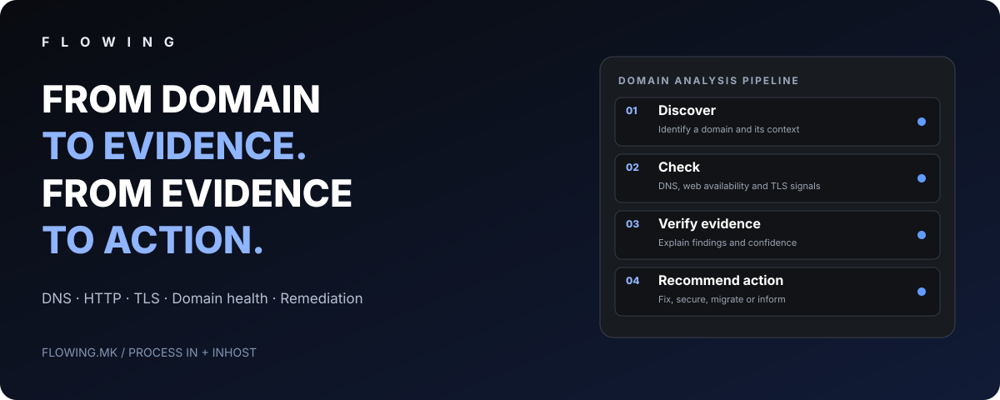

[Македонски](README.mk.md) · [English](README.md) · [Shqip](README.sq.md) · [Türkçe](README.tr.md)

# F L O W I N G

### Nga domeni te vendimi i mbështetur në prova.

**Nga domeni te vendimi i mbështetur në prova.**

---

## Platforma FLOWING

**FLOWING**, nga **PROCESS IN**, lidh zbulimin e domeneve, kontrollin teknik, provat, vlerësimin e rrezikut, inteligjencën e biznesit dhe korrigjimin praktik. Siguria dhe diagnostikimi email janë dy fusha brenda një platforme më të gjerë, jo përkufizimi i gjithë produktit.

## Harta e mundësive

| Fusha | Fushëveprimi |
|---|---|
| **Zbulim dhe regjistër** | Inventar domenesh, të dhëna MARNET, transparencë certifikatash, skedarë zone, rakordim burimesh, deduplikim dhe regjistrim. |
| **Cikli dhe monitorimi** | Domene të reja, verifikim regjistrimi, sinjale skadimi, ndryshime dhe histori. |
| **DNS dhe infrastrukturë** | A/AAAA/CNAME/NS/MX, qasje web, HTTP/HTTPS, zinxhirë ridrejtimi, SSL/TLS dhe anomali. |
| **Siguria e faqes** | Google Web Risk, URL të dyshimta, reputacion malware/phishing dhe konfigurim. |
| **Email dhe reputacion** | MX, SPF/DKIM/DMARC, SMTP, dërgueshmëri, reputacion IP/domeni dhe lista bllokimi. |
| **Teknologjia dhe cilësia** | CMS, tregues cenueshmërie, performancë, zbulueshmëri dhe SEO teknike. |
| **Provat** | Histori kontrollesh, regjistra, besueshmëri, kontekst dhe verifikim njerëzor. |
| **Kontaktet dhe kompanitë** | Pasurim kontaktesh publike biznesi, përputhje kompanish, prejardhje dhe deduplikim. |
| **Mundësitë** | Klasifikim, përparësi, pikëzim, shqyrtim dhe përshtatje shërbimesh. |
| **Motori tregtar** | Lidhje shërbimesh, oferta, PDF dhe rekomandime korrigjimi ose migrimi. |
| **Email Studio** | Shabllone, komunikim me kontroll shqyrtimi dhe ndjekje. |
| **Automatizim dhe administrim** | Zbulim i kontrolluar, kufij ritmi, radhë, kontrolle të planifikuara, import dhe panele. |
| **Analizë publike — e planifikuar** | Domen i dhënë nga klienti, raport i kuptueshëm, ofertë për problem të verifikuar ose njoftim pa problem. |

Harta paraqet arkitekturën dhe fushëveprimin e zhvillimit. Modulet dhe kontrollet janë në faza të ndryshme; nuk do të thotë se çdo element është publik. Qasja aktuale është private.

## Inteligjencë dhe gjendje teknike

Platforma lidh kontrollet me prova të regjistruara dhe shqyrtim njerëzor për të kthyer probleme të mundshme në rekomandime. **Nuk është drejtori publike pronarësh domenesh** dhe nuk publikon regjistra privatë biznesi.

Kontrollet përfshijnë sinjale virusi e malware, përmbajtje dhe ridrejtime të dyshimta; paralajmërime Google Safe Browsing / Web Risk për phishing, manipulim dhe softuer të padëshiruar; reputacion e lista bllokimi IP/domeni; rutim email, autentikim dhe dërgueshmëri; anomali DNS; gabime HTTP dhe disponueshmëri; skadim ose mospërputhje certifikate; tregues CMS dhe ekspozimi.

Historia, burimet, ashpërsia dhe rishikimi ndihmojnë dallimin mes problemit të sigurisë, konfigurimit, reputacionit ose domenit të shëndetshëm. Sinjali në listë reputacioni nuk provon vetë infeksion aktiv; rezultat i pastër nuk garanton siguri.

## Nga prova te veprimi

1. **Zbuloni:** domenin dhe sinjalet publike.
2. **Kontrolloni:** DNS, web, ridrejtime dhe TLS.
3. **Verifikoni:** gjetjet, provat dhe kontekstin.
4. **Vendosni:** korrigjim, hetim shtesë ose pa veprim.
5. **Rekomandoni:** riparim, mbrojtje, mirëmbajtje ose migrim kur arsyetohet.
6. **Informoni:** pa shpikur probleme ose ushtruar presion kur nuk ka gjetje.

## Qasja aktuale dhe shërbimi publik i planifikuar

| Tani | I planifikuar, jo i hapur |
|---|---|
| Hapësirë e brendshme inteligjence | Formular publik domeni |
| Kontrolle DNS/HTTP/TLS | Vlerësim sipas kërkesës |
| Histori dhe shqyrtim manual | Raport për klientin |
| Rekomandime të shqyrtuara | Ofertë opsionale për problem të verifikuar |
| Punë private PROCESS IN / INHOST | Email informues kur nuk ka problem |
| Bazë teknike shërbimesh | Konsultim opsional migrimi dhe sigurie |

Platforma është LIVE si hapësirë e brendshme. Kjo nuk nënkupton regjistrim publik. Shtresa publike është drejtim i ardhshëm.

## Pse kjo qasje

Prova para përfundimeve; shqyrtim njerëzor aty ku ka rëndësi; vendim praktik në vend të pikëzimit alarmues; raportim i shëndetshëm kur nuk ka problem. Gjetjet e verifikuara mund të lidhen me ndihmë nga PROCESS IN dhe **[INHOST](https://inhost.mk)**.

Audienca e shërbimit të ardhshëm përfshin pronarë faqesh, biznese me probleme DNS/SSL/disponueshmërie, organizata që shqyrtojnë infrastrukturë ose migrim dhe ekipe që kërkojnë prova të kontrollueshme.

**Analizoni me prova. Rekomandoni me besim.**

## Informacion për produktin

| Hollësia | Vlera |
|---|---|
| Produkti | FLOWING |
| Faqja zyrtare | [flowing.mk](https://flowing.mk) |
| Kategoria | Inteligjencë domenesh dhe gjendje teknike faqesh |
| Statusi | LIVE |
| Zhvilluesi | [PROCESS IN](https://processin.mk) |
| Portofoli | [PROCESS IN](https://github.com/stambolce/process-in) |

### [Vizitoni FLOWING](https://flowing.mk)

Nuk publikohen kodi privat, të dhëna domenesh ose kontaktesh, rrjedha pronësore, kredenciale ose konfigurime infrastrukture. Kontrollet janë vëzhgime të çastit, jo garanci sigurie ose disponueshmërie. Nuk nënkuptohen certifikim, konfirmim incidenti ose rezultate klienti.

---

This platform is a digital product of <a href="https://processin.mk" target="_blank" >PROCESS IN </a>· Your Enterprise Software & AI Partner ·  Hosted on Enterprise Infrastructure by <a href="https://inhost.mk" target="_blank">INHOST</a>·
